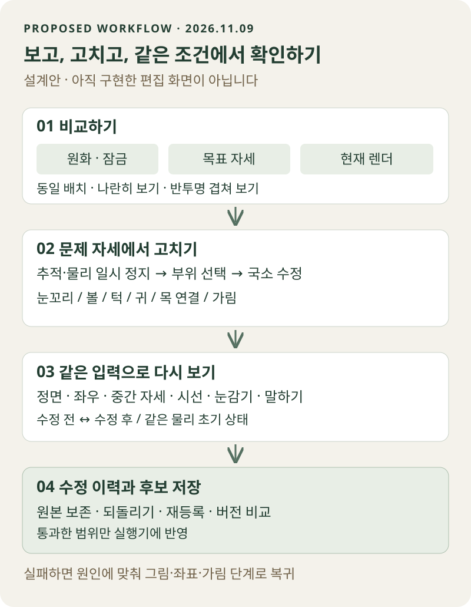

지금 아바타 프로젝트에서 가장 필요한 것은 **원화의 인상을 유지하면서 고개가 돌아가는 머리 시제품**이다. 정면 그림과 실행 프로그램은 나아졌지만, Hiyori·Akari를 참고한 자연스러운 움직임이라는 목표에는 아직 도달하지 못했다.

이번 연구에서는 회전 계산의 문제를 분리하고 네 가지 다음 과제를 정했다. **방향별 기준 그림, 그 그림을 재현하는 변형, 작은 시제품, 고정된 비교 절차**다. 여기에 사용자의 피드백으로 중요한 조건이 더해졌다. **사람이 화면을 보고 세부 형태를 직접 수정하고, 그 수정을 다음 작업에 남길 수 있어야 한다.**

이 글은 [이전 워크플로우 재검토](/research/avatar-workflow-art-and-motion-review/)의 후속이다. 2026년 11월 9일 연구 결과와 이후 구현할 설계를 구분한다. 개발 저장소와 캐릭터 소재는 비공개이며, 품질 검증과 공개 준비를 마친 뒤 별도로 안내할 예정이다.

## 1. 무엇이 좋아졌고, 무엇이 아직 부족한가

| 영역 | 현재 판단 | 다음에 확인할 것 |
| --- | --- | --- |
| 정면 인상 | 컨셉 → 확정 메인 → 원본 보존 소재 방식으로 개선 | 회전 중에도 같은 캐릭터로 읽히는가 |
| 머리카락 | 작은 움직임에서 연속된 가시 소재와 공통 변형으로 절단 문제 완화 | 큰 진폭과 풍부한 가닥 표현은 별도 검증 |
| 상체 | 허리를 기준으로 윗부분이 기울어지는 구조 마련 | 얼굴 위치로 추정한 움직임과 실제 몸 관측을 구분 |
| 고개 회전 | 이목구비 쏠림과 약한 윤곽·가림 변화가 남음 | 원하는 옆얼굴을 먼저 정하고 실제로 재현 |
| 실행 앱 | 더블클릭 실행·송출 창·위치 복원에 대한 이전 검사 기록 확보 | 이번 후보의 실제 추적·방송은 별도 확인 |

Teal Café Rig 03은 현재 가장 유용한 기준점이다. 잘된 정면과 몸통까지 다시 만들기보다 머리 문제를 별도의 후보에서 해결하려 한다.

이전 앱의 43개 단위 검사와 실행파일 검증을 이번 연구에서 다시 수행한 것은 아니다. **파일이 정상이고 화면이 움직이는 것, 보기 좋은 형태로 움직이는 것, 실제 방송에서 안정적인 것은 각각 다른 통과 조건**이다.

[Hiyori 사진과 Silver Braid의 비교 연구](/research/hiyori-silver-braid-head-motion-study/)도 계속 참고한다. 다만 간격을 두고 촬영한 사진으로는 전환 속도·가속도·머리카락 지연을 복원할 수 없다. 서로 다른 캐릭터의 사진을 같은 회전각의 정답으로 사용하지 않는다.

## 2. 얼굴이 쏠리는 문제와 좌표 기준 문제를 나눠 보았다

### 현재 얼굴에는 돌아간 뒤의 형태가 부족하다

현재 머리는 정면 그림의 위치마다 가정한 깊이를 주고 회전시킨다. 깊이가 다르면 눈·입·턱의 화면상 이동량도 달라진다.

현재 설정의 한 좌우 회전 입력에서 눈 중심 평균과 턱 기준점의 수평 이동 차이는 약 **14.08 모델 픽셀**이었다. 기준 캔버스는 1122×1402다. 이 수치는 인체 길이나 Hiyori와의 오차가 아니며, 그 자체로 잘못된 변형을 뜻하지도 않는다.

원근이 생기면 얼굴의 보이는 폭과 눈 간격은 변한다. 문제는 **가정한 깊이가 이 캐릭터의 자연스러운 옆얼굴을 보장하지 않는다는 점**이다. 윤곽과 가림이 충분히 변하지 않은 채 눈코입의 이동이 두드러지면 얼굴 위에서 부품이 미끄러지는 인상이 난다.

### 좋은 목표를 넣어도 계산 기준이 다르면 어긋난다

별도로, 앞으로 방향별 키폼을 넣을 때의 통합 문제도 확인했다. 키폼은 특정 입력값에서 원하는 형태를 저장한 데이터다.

고정해서 사용 중인 LivLiv 경로는 목표와 기본 변형의 차이를 보정값으로 준비한다. 그런데 우리 확장이 나중에 기본 머리 변형을 바꾸면 다음과 같은 일이 생길 수 있다.

```text
보정값 = 목표 위치 - 예전 기본 변형
최종 위치 = 새 기본 변형 + 보정값
          = 목표 위치 + 두 기본 변형의 차이
```

이것은 **우리 확장과 키폼 계산을 연결하는 기준의 문제**다. LivLiv 전체의 결함이라는 뜻이 아니다. 현재 모델에는 방향별 키폼이 없으므로, 이 문제를 지금 보이는 얼굴 쏠림의 직접 원인으로 설명해서도 안 된다.

## 3. 좌표 실험에서 확인한 것과 확인하지 못한 것

목표 형태를 제대로 재현하는지 알아보기 위해 모든 방향의 목표를 일부러 정면으로 지정했다. 자연스러운 고개 회전 예제가 아니라 **계산 경로의 오차를 드러내는 인공 시험**이다.

| 계산 경로 | 좌우 끝 입력 | 좌우＋상하 끝 입력 | 두 축의 중간 입력 |
| --- | ---: | ---: | ---: |
| 예전 기준 보정＋새 기본 변형 | 10.80194px | 13.30478px | 5.75991px |
| 실제 기준으로 축별 보정 | 0.00003px | 5.07800px | 1.45695px |
| 같은 축 보간＋모서리 보정 | 0.00003px | 0px | 0.54376px |
| 목표 좌표를 직접 보간한 시제품 | 0px | 0px | 0px |

값은 얼굴·눈·눈썹·입 정점의 최대 목표 좌표 오차다. 입력은 각각 X/Y=(18,0), (18,14), (9,7)이며 **실제 머리의 측정 각도가 아니다.** 축 보정과 모서리 보정 비교에는 같은 축 보간 방식을 유지했다.

끝자세가 맞아도 중간 자세는 별도로 확인해야 한다는 결과다. 목표 좌표를 직접 연결하는 연구 모듈은 위치와 자세에 따라 달라지는 알려진 좌표장 150조건에서도 확인했다. 전체 연구는 5개 계산 경로×10개 자세, 12개 계약 검사로 범위를 기록했다. [공개용 수치와 실험 조건](/assets/files/avatar-head-targets/coordinate-study-summary.json)에서 확인할 수 있다.

**0px는 자연스러운 얼굴의 완성을 뜻하지 않는다.** 목표 자체가 정면 고정이었기 때문이다. 연구 모듈은 방송 앱에 통합하지 않았고, 새로운 좌우 원화도 아직 만들지 않았다. 좋은 그림·정확한 좌표·자연스러운 보간·올바른 가림이 함께 필요하다.

## 4. 합의한 네 가지 다음 과제

### ① 돌아간 뒤의 기준 그림을 먼저 만든다

정면은 승인한 메인 일러스트를 그대로 쓴다. 여기에 왼쪽·오른쪽을 바라보는 기준 그림 두 장을 먼저 준비한다. 눈코입만 옆으로 옮기는 그림이 아니라 볼·턱·코·가까운 눈과 먼 눈·귀·앞머리의 관계가 함께 성립해야 한다.

참고 그림과 실제 소재는 역할이 다르다. 방향별 참고 그림을 통째로 섞어 표시하지 않는다. 보이는 정면 소재는 원본을 유지하고, 회전으로 새로 드러나는 영역이나 필요한 새 상태만 보완한다. 좌우 반전도 비대칭 디자인을 고려해 검토해야 한다.

### ② 그 형태에 도달하는 좌표를 만든다

같은 원화 정점과 UV, 즉 그림을 읽는 위치를 유지하면서 자세별 목표 위치를 등록한다. 여기서 '절대 목표'는 화면 배치를 고정한다는 뜻이 아니다. **같은 모델 기준 공간에서 정한 목표 형태를 직접 재현한다는 뜻**이다.

머리 좌우·상하 변형을 이 경로에서 적용했다면 예전 깊이 회전을 다시 더하지 않는다. 눈동자와 입의 국소 움직임은 머리의 변형을 함께 따라가고, 가림은 마스크와 그리기 순서로 처리한다. 단순한 좌표 보간 하나가 새로 드러나는 피부나 머리카락을 만들어 주지는 않는다.

Cubism의 [키폼 등록](https://docs.live2d.com/en/cubism-editor-manual/edit-parameters/), [부모·자식 구조](https://docs.live2d.com/en/cubism-editor-manual/system-of-parent-child-relation/), [XY 모서리 형태](https://docs.live2d.com/en/cubism-editor-manual/synthesize-corners/)를 이러한 원리를 이해하는 자료로 참고한다. 특정 편집기나 비공개 키트의 내부 구현을 복제했다는 뜻은 아니다.

### ③ 머리 전용 후보 하나로 먼저 검증한다

기존 앱과 몸통·머리카락 구조는 보존한다. 처음에는 좌우만 구현하고, 통과한 뒤 상하와 대각선으로 넓힌다. 원화 재제작, 새 물리 엔진, 범용 편집기를 동시에 추진하지 않는다.

메쉬를 더 촘촘하게 만드는 것은 승인된 윤곽이나 눈꺼풀을 표현하기 부족한 부위에서 검토한다. 정점 수나 슬라이더 수는 품질 목표를 대신하지 못한다.

### ④ 같은 입력을 반복해 비교한다

정면 → 왼쪽 → 정면 → 오른쪽, 머리 고정＋시선만 이동, 회전＋눈감기＋입 움직임, 방향 반전과 정지를 고정 입력으로 재생한다. 원화·기존 버전·수정 버전을 같은 크기와 조건으로 확인한다.

수치 통과와 시각 승인, 실제 VTube Studio(VTS) 추적과 OBS 방송 검증은 따로 기록한다. 얼굴 위치를 이용한 상체 추정도 실제 어깨·골반을 관측한 것으로 표현하지 않는다.

## 5. 추가 과제: 사람이 보고 고칠 수 있는 최소 제작 화면

자동 생성 결과를 보고 “눈꼬리가 너무 올라갔다”라고 판단해도 수정하려면 다시 코드와 파일을 오가야 했다. 이 과정은 검토 비용이 크고, 어느 자세의 무엇을 고쳤는지 남기기 어렵다.

필요한 것은 **AI가 초안을 만들고 사람이 특정 자세의 외형을 고친 뒤, 같은 입력으로 바로 재검사하는 도구**다. 기존 방송 화면을 복잡하게 만들지 않고 제작용 화면으로 분리한다.

<figure style="margin:1.8rem 0;">
<a href="/assets/images/avatar-head-targets/editor-workflow.svg"></a>
<figcaption>앞으로 만들 최소 편집 절차의 설계도다. 실제 구현 화면이나 완성 아바타의 시연이 아니다. 눌러서 크게 볼 수 있다.</figcaption>
</figure>

| 도구 | 사람이 하는 일 | 잘못된 수정을 막는 조건 |
| --- | --- | --- |
| 원화·목표·현재 결과 비교 | 나란히 보기와 반투명 겹쳐 보기로 인상·경계 확인 | 같은 확대율·배치 사용, 정면 원본은 잠금 |
| 자세 고정 | 좌우·상하 입력을 멈추고 문제 부위 확대 | 실시간 추적과 자동 물리를 잠시 정지 |
| 기준점·윤곽 편집 | 눈꼬리·볼·턱·귀·목 연결을 국소적으로 이동 | 선택한 자세와 부위만 수정, 정면·인접 부위 보호 |
| 가림·연결 확인 | 눈꺼풀·홍채·머리카락의 가림과 겹침 확인 | 단독 파츠와 합성 화면을 함께 검사 |
| 같은 동작 재생 | 같은 입력의 수정 전·후와 중간값 비교 | 입력·모델 버전·물리 초기 상태 고정 |
| 이력 저장 | 되돌리기, 다시 실행, 후보 저장, 이전 상태 복원 | 원본을 덮어쓰지 않고 수정 데이터 별도 보관 |

**슬라이더로 동작을 시험하는 것과, 그 동작의 형태를 고치는 것은 다르다.** 전자는 “얼마나 돌아볼까”이고 후자는 “이 자세에서 볼과 눈은 어디에 있어야 할까”다. 조절 가능한 항목을 늘리는 것만으로 후자의 문제가 해결되지는 않는다.

첫 구현은 머리의 좌·정면·우 선택, 원화 겹쳐 보기, 소수의 기준점 이동, 되돌리기와 저장, 고정 재생부터 시작한다. 픽셀을 다시 그려야 하는 문제는 외부 이미지 편집이나 필요한 영역 재생성으로 넘기고, 결과를 다시 등록한다. 처음부터 그림 도구 전체를 만들 필요는 없다.

### 사람이 고친 내용은 어디에 남겨야 하나

수정은 화면 안의 일회성 상태가 아니라 **원본 버전, 자세 입력, 대상 부위, 수정 전후 좌표, 가림 설정, 검토 상태**를 가진 데이터로 남겨야 한다. AI가 소재를 다시 생성해도 승인된 수정을 조용히 덮어쓰지 않도록 한다.

원본이나 메쉬 구조가 바뀌면 기존 수정의 기준이 유효한지 검사하고, 맞지 않으면 재등록 대상으로 표시한다. 예전 좌표를 새 소재에 무조건 적용하지 않는다. 편집 미리보기와 실행 프로그램은 같은 변형 코드를 사용해야 한다. 그렇지 않으면 편집기에서는 맞고 송출에서는 어긋나는 문제가 다시 생긴다.

## 6. 실제 수정은 이런 순서로 진행한다

예를 들어 오른쪽을 보는 중간 자세에서 먼 쪽 눈이 과하게 몰린다고 가정하자. 아래는 **향후 도구에서 수행할 예시이며, 이미 고친 결과가 아니다.**

1. 문제가 보이는 입력값과 프레임을 저장하고 움직임을 멈춘다.
2. 원화와 승인된 방향 참고 그림을 같은 배치로 비교한다.
3. 목표 그림 자체가 이상하면 그림 단계로, 목표와 렌더가 다르면 좌표 등록 단계로 돌아간다.
4. 눈의 기준점과 주변 변형을 조정하되 볼·눈꺼풀·앞머리의 가림도 함께 확인한다.
5. 선택 자세뿐 아니라 정면, 인접한 중간값, 반대 방향에서 부작용을 검사한다.
6. 시선·깜박임·입 움직임을 더한 동일 재생을 확인하고 새 후보로 저장한다.

| 발견한 문제 | 먼저 되돌아갈 곳 |
| --- | --- |
| 방향 그림부터 다른 얼굴로 보임 | 기준 그림 제작·선택 |
| 기준점은 맞는데 윤곽이 울거나 눈이 찌그러짐 | 메쉬 대응·변형의 영향 범위·중간 형태 |
| 피부 대신 빈 공간이 보임 | 숨은 영역 소재와 마스크 |
| 머리카락이 이중으로 보임 | 소재 소유권과 그리기 순서 |
| 멈춘 자세는 좋지만 전환 중 튐 | 보간·연속성·물리와 입력 보정 |
| 실제 추적에서만 과하게 흔들림 | 입력 범위·감도·노이즈 처리 |

반복은 “결과가 나쁠 때 더 많이 생성한다”가 아니다. **실패 종류를 기록하고 해당 단계로 돌아가는 것**이다. 같은 부위를 같은 방법으로 반복해도 좋아지지 않으면 범위를 줄이거나 기준 그림을 다시 정해야 한다.

## 7. 외부 키트에서 얻은 영감과 우리 방식의 경계

Inori(@lnkiai)는 [공식 사이트](https://lnkiai.com/)에서 한 장의 일러스트를 Live2D 모델로 만드는 키트를 개발 중이라고 소개한다. [11월 7일 발표](https://x.com/lnkiai/status/2119019264824979666)의 약 3분·최소 4장과 [11월 8일 발표](https://x.com/lnkiai/status/2119356681603670150)의 무료 오픈소스 공개 계획은 **제작자의 발표**다.

검토한 공개 자료만으로 키트 전체의 생성·리깅·내보내기 경로를 재현하거나 그 시간을 독립 검증하지 못했다. 생성 그림 수, 파일 수, 파츠 수, 자세 수는 다른 개념이다. “4장”을 우리 프로젝트의 고정 요구사항으로 삼지 않는다.

우리가 가져갈 질문은 생성 호출 수보다 **형태를 정하는 단계와 조립·검수 단계를 어떻게 연결할 것인가**다. 공개를 기다리거나 비공개 구조를 추정하는 대신, 이번 실험과 직접 확인할 수 있는 기준으로 제작 경로를 설계한다.

현재 프로젝트는 VTS에서 추적값을 받아 자체 실행기로 렌더하는 경로다. **VTS 모델 목록에 직접 넣는 네이티브 Live2D 파일(`.moc3`) 출력은 아직 구현하지 않았다.** 이 출력 형식 문제와 화면상의 움직임 품질은 별도 과제로 관리한다.

## 8. 다음 작업의 범위와 완료 조건

다음 작업은 **좌우 기준 그림 두 장＋머리 전용 후보＋최소 수정·재생 화면**으로 한정한다. 사람의 수정 기능도 그 후보를 검토하는 데 필요한 만큼만 만든다.

| 관문 | 통과해야 하는 결과 |
| --- | --- |
| 정면 보존 | 메인과 승인된 정면 외형이 유지됨 |
| 목표 재현 | 지정한 좌표를 재현하고 다른 회전이 중복 적용되지 않음 |
| 시각 품질 | 끝과 중간 자세에서 동일 인상, 자연스러운 윤곽·가림·목 연결 |
| 편집 지속성 | 저장 후 다시 열어도 수정이 유지되고 되돌릴 수 있음 |
| 복합·연속 | 회전＋눈감기＋말하기와 방향 반전에서 틈·이중상·튐이 없음 |
| 후보 반영 | 기존 모델 보존, 실제 추적·방송 확인 여부를 별도 표시 |

좌표 재현 오차는 초기에는 0.5 모델 픽셀 이내를 시험 기준으로 삼되, 외형 승인을 대체하지 않는다. 승인된 범위 밖의 큰 회전까지 억지로 확장하지 않는다.

아직 자연스러운 새 머리 회전이나 편집기를 완성한 것은 아니다. 이번에 확보한 것은 **무엇을 먼저 만들어야 하고, 사람이 어디서 개입하며, 실패하면 어디로 돌아가야 하는지**를 좁힌 개발 방향이다. 다음 판단은 이 방향으로 만든 작은 시제품의 실제 모습으로 내려야 한다.
