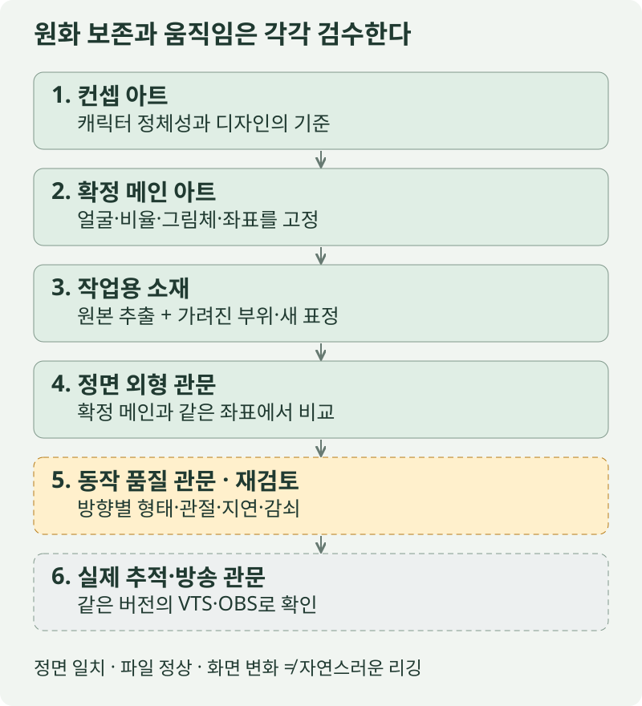
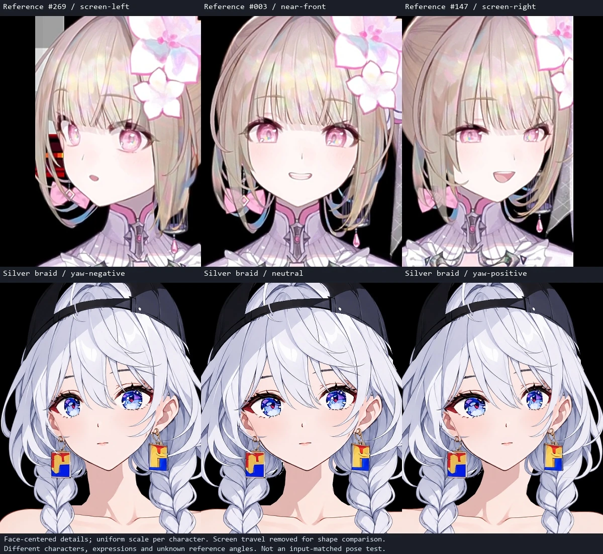

새 아바타를 직접 살펴본 뒤 받은 평가는 두 갈래였다. **원화와 캐릭터 인상은 이전보다 좋아졌다. 그러나 몸통은 너무 크게 옆으로 움직이고, 고개를 돌리면 얼굴이 찌그러지며, 머리카락은 거의 움직이지 않는다.**

이번 글은 이 차이가 어디서 생겼는지 기록한다. 이전 제작 방식과 현재의 **컨셉 아트 → 메인 아트 → 작업용 아트**를 비교하고, 현재 실행 코드와 고정 입력을 점검했다. **프로젝트 성패의 핵심 기준은 같은 얼굴을 유지하는 자연스러운 머리 회전과 시선 처리다.** 정면 그림의 개선과 그 목표의 달성을 구분해서 읽어야 한다.

[초기 제작 기록](/projects/mesh-avatar-studio/), [Hiyori와 Silver Braid의 고개 연구](/research/hiyori-silver-braid-head-motion-study/), [LivLiv Player 사용 기록](/notes/livliv-player-getting-started/)에 이어지는 검토다. **개발 저장소와 새 캐릭터 소재는 현재 비공개이며, 공개 준비 이후 별도로 안내할 예정이다.**

## 1. 무엇을 바꿨기에 원화가 나아졌나

초기의 모든 작업이 같은 방식이었던 것은 아니다. 이미 독립 파츠와 숨은 영역 복원도 시도했다. 여기서 비교하는 이전 실패는 특히 **피부·눈·머리 같은 보이는 부위를 따로 재생성한 뒤 재조립하며 정면 인상이 달라졌던 시도**다.

| 항목 | 이전 실패에서의 문제 | 현재 제작 방식 |
| --- | --- | --- |
| 컨셉과 제작 기준 | 참고 그림과 생성된 파츠가 서로 다른 형태·비율 기준을 따름 | 컨셉은 디자인을, 확정 메인은 모든 소재의 그림체·비율·좌표를 정의 |
| 얼굴과 눈 | 각 파츠는 그럴듯해도 조립하면 낯선 얼굴이 됨 | 보이는 피부·홍채·속눈썹·기본 입은 메인에서 추출 |
| 생성 AI의 역할 | 이미 보이는 얼굴까지 다시 그림 | 새 메인 단계에서 디자인을 정리하고, 고정 이후에는 숨은 영역과 없는 표정만 제작 |
| 좌표 등록 | 개별 그림의 경계 상자에 맞추며 크기와 비율이 변함 | 눈꼬리·홍채·입·턱의 원래 위치를 유지하고 임의의 가로세로 압축을 금지 |
| 검수 | 파일 정상·메시 정상·움직임 발생에 집중 | 메인과 같은 좌표의 정면 외형 검사를 별도로 추가 |

새 컨셉은 전신 자료라 얼굴이 작았다. 먼저 머리부터 허리까지의 메인 일러스트를 만들고 인상과 디자인을 확인했다. 이후에는 그 그림을 고정했다. 이 구분이 있어야 생성할 때마다 얼굴이 조금씩 바뀌는 문제를 줄일 수 있다.

현재 예제는 **23개 레이어·30개 활성 텍스처 파일·45개 제어 항목**으로 구성했다. 직전 제작 기록에는 정면 보호 영역에서 정한 채널 오차 4를 넘은 픽셀이 0개였다고 남아 있다. 이것은 **허용 오차 안에서 정면 외형을 보존했다는 뜻**이며 모든 RGBA 값이 완전히 같거나 움직임도 아름답다는 뜻은 아니다.

<figure style="margin:1.8rem 0;">

<figcaption>제작 흐름에서 역할을 나눈 것이 정면 외형의 개선에 도움이 됐다. 노란색 동작 품질 단계는 이번 피드백에서 다시 미통과로 판단한 관문이다.</figcaption>
</figure>

## 2. 무엇을 통과했다고 잘못 해석했나

직전 검수는 단위·계약 테스트 28개, 정적 자세 16개, 합성 입력 480프레임, 45개 제어의 화면 변화와 정면 복귀를 확인했다. 실행파일·송출 창·재시작 검사도 남아 있다. 각각 필요한 검사다.

그러나 **화면이 변했다는 검사에는 무엇으로 변했는지가 빠져 있었다.** '상체 회전' 슬라이더가 그림을 옆으로 밀어도 화면 비교는 통과한다. 머리카락 정적 보정이 한 번 적용돼도, 자연스러운 관성이나 지연이 구현됐다고 판단할 수 없다.

| 확인한 사실 | 추가로 확인해야 할 품질 |
| --- | --- |
| 정면이 메인과 일치함 | 회전 중에도 같은 인상과 이목구비가 유지되는가 |
| 메시가 접히지 않고 수치가 유한함 | 멈춘 옆얼굴의 볼·턱·눈·코 관계가 설득력 있는가 |
| 45개 항목에서 화면 변화가 생김 | 이름에 맞는 회전·관절·표정·물리인가 |
| 마지막에 정면으로 돌아옴 | 중간 경로에서 눌림·늘어남·접합 문제가 없는가 |
| 실행·모의 연결·출력 복구가 동작함 | 실제 추적과 방송 환경에서도 자연스럽고 안정적인가 |

후속 사용 검토에서는 상체 과이동, 얼굴 변형, 약한 머리카락 움직임, 부족한 가슴·옷의 추종이 지적됐다. 따라서 현재 결과는 **원화 제작 흐름의 진전이 있는 리깅 연구 후보**로 평가한다. Hiyori 수준의 동작 품질은 미달이다.

## 3. 몸통: 그림 하단 고정과 허리 고정은 달랐다

현재 채택한 재생기는 [LivLiv Player 0.3.0의 고정 소스](https://github.com/livliv-dev/player/tree/0ffb70f2b815d924ab10b07fa892c413846a71cd)를 바탕으로 한다. 그 위에 자체 소재·입력 매핑·파츠별 보정이 얹혀 있다. 여기서 발견한 결과는 **현재 모델과 설정의 결과**이며, 다른 LivLiv 모델의 한계까지 증명하지 않는다.

코드를 보면 상체 좌우 입력은 상체를 옆으로 밀고 좌우를 약하게 압축하는 근사다. 상체 기울기는 그림 아래쪽보다 더 아래에 둔 피벗을 사용하고, 그림 하단으로 내려갈수록 영향이 줄어든다. **옷의 허리대가 있는 지점을 고정한 구조가 아니다.** [해당 재생기의 몸통 변형 구현](https://github.com/livliv-dev/player/blob/0ffb70f2b815d924ab10b07fa892c413846a71cd/src/runtime/puppet.ts)

이번 진단은 1122 × 1402 모델 좌표에서 각 입력을 단독으로 주고 150회 안정화한 뒤, 가슴·허리대·밑단 주변에 지정한 가장 가까운 메시 정점을 측정했다. 위치 이동·호흡·표정 입력은 중립이었다.

| 단독 입력 | 가슴 중앙 부근의 가로 이동 | 허리대 중앙 부근의 가로 이동 | 그림 하단 부근의 가로 이동 |
| --- | ---: | ---: | ---: |
| 상체 좌우 `bodyX = +6` | 8.16px | 2.97px | 0.01px |
| 상체 기울기 `bodyZ = +6` | 76.63px | 23.83px | 0.11px |
| 고개 좌우 `angleX = +18` | 4.16px | 1.52px | 0.01px |

입력 숫자는 같은 실제 신체 각도를 뜻하지 않는다. 픽셀도 방송 화면의 픽셀이 아닌 모델 좌표다. 지정 위치와 실제 메시 정점 사이에는 약 3~5px의 차이가 있었다.

이 결과는 사용자가 느낀 큰 좌우 흔들림을 설명한다. 특히 기울기 입력의 큰 레버 길이와 고개에 대한 상체 추종, 별도 전체 위치 이동이 합쳐질 수 있다. **그림 밑단이 거의 멈춰 있어도 허리는 상당히 움직인다.**

다음 구조는 허리 기준점, 흉곽, 양 어깨와 팔의 연결을 나눠야 한다. 몸 전체의 위치 이동은 별도 정책으로 남기되, 이번 목표인 허리 고정 모드에서는 제한한다. 흉곽을 옆으로 미는 효과와 방향에 따른 폭·가림이 달라지는 회전도 구분해야 한다.

## 4. 얼굴: 원본 픽셀을 지켜도 변형 함수는 얼굴을 바꿀 수 있다

보이는 얼굴을 다시 그리지 않아도, 그 그림이 올라간 메시를 잘못 변형하면 인상은 달라진다. 현재 후보는 공통 곡면으로 머리 깊이를 근사한다. **이목구비를 같은 곡면에 태우는 것과 그 캐릭터의 좋은 옆얼굴을 만드는 것은 다른 작업이다.**

현재 모델에는 승인된 방향별 보정 키폼이 없다. 큰 회전을 줄인 상태에서도 눈·볼·턱에 서로 다른 국소 배율이 생긴다. 이번에는 얼굴과 열린 눈의 메시 삼각형에서 2차원 변형을 계산하되, 각 삼각형의 중심점에서 소재 알파가 235 미만인 것은 제외했다. 앞머리 등에 가려지는 영역까지 최종 합성의 가시성을 판정한 측정은 아니다.

'방향별 배율비'는 국소 변형이 가장 많이 늘어나는 방향과 가장 적게 늘어나는 방향의 배율을 나눈 값이다. 1이면 두 방향의 배율이 같다.

| 고정 입력 | 얼굴 국소 배율비 중앙값 | 얼굴 국소 배율비 95백분위 |
| --- | ---: | ---: |
| 정면 | 1.00 | 1.00 |
| 좌우 끝 `angleX = ±18` | 약 1.13 | 약 1.30 |
| 위 보기 `angleY = +14` | 약 1.07 | 약 1.16 |
| 아래 보기 `angleY = -14` | 약 1.08 | 약 1.19 |
| 대각 `X = 18, Y = 14, Z = 8` | 약 1.15 | 약 1.32 |

검사한 얼굴 삼각형 483개에서는 뒤집힘이 없었다. 그래도 국소적인 비균일 변형은 남았다. **배율비 1.30은 얼굴이 30% 못생겨졌다는 뜻도, 그 부위가 통째로 30% 커졌다는 뜻도 아니다.** 정상적인 원근에도 비균일 변형은 생긴다. 이 수치는 어디를 확대 검토할지 찾는 진단값이다.

최종 판정에는 방향별 기준 형태가 필요하다. 가까운 눈과 먼 눈, 코의 돌출, 볼의 면, 턱과 목의 접합, 옆머리와 귀의 가림이 같은 방향을 설명해야 한다. 다음 그림은 **지난 Hiyori 연구의 비교 자료**이며 이번 새 모델의 렌더가 아니다.

<figure style="margin:1.8rem 0;">

<figcaption>2026-10-26 연구에서 공개한 방향 비교. 서로 다른 캐릭터·입력의 선택 사진이다. Hiyori의 실제 각도·속도나 이번 후보와의 동기화된 A/B를 뜻하지 않는다. <a href="/research/hiyori-silver-braid-head-motion-study/">원래 연구의 조건과 한계</a>를 함께 읽어야 한다.</figcaption>
</figure>

다음에는 메인 얼굴을 유지하면서 작은 좌우·상하 기준 형태부터 승인하고, 그 형태에 맞춰 메시와 가려진 면을 교정한다. 대각 방향도 따로 검토한다. [Cubism의 X·Y 키폼 예제](https://docs.live2d.com/en/cubism-editor-manual/keyform-xydirection/) 역시 두 축을 묶은 여러 상태를 각각 다룬다. 다만 '9장 만들기' 자체가 합격 조건은 아니다. **각 상태와 그 사이 경로에서 같은 얼굴로 읽혀야 한다.**

## 5. 머리카락과 바스트: 정적 보정과 시간에 따른 반응을 분리한다

### 머리카락은 연결돼 있지만 상대 움직임이 너무 작았다

앞머리·옆머리·긴 머리·바보털과 장식에 체인 설정이 있다. 그러나 현재 후보는 바람과 늘어뜨림 항을 0으로 두고, 주로 뿌리 가속도에 반응한다. 강성이 크고 반응도 보수적이다.

고개 좌우를 진폭 10, 주파수 0.35Hz로 부드럽게 움직이고 기울기도 작게 섞은 5초 합성 입력에서, 체인의 정지 형태 대비 **한 좌표축 최대 상대 변위**는 다음과 같았다. 적분은 초당 60회이며 실제 방송 성능 측정은 아니다.

| 부위 | 최대 상대 변위 |
| --- | ---: |
| 좌우 앞머리 | 약 0.16~0.19 모델 px |
| 좌우 옆머리 | 약 0.25~0.26 모델 px |
| 좌우 긴 머리 | 약 0.43 모델 px |
| 바보털 | 약 0.22 모델 px |

머리와 함께 옮겨지는 양을 제외한 값이다. 화면에서 축소하면 더욱 알아보기 어렵다. 따라서 사용자의 '머리카락이 움직이지 않는다'는 체감에는 근거가 있다.

추가로 고개 각도를 고정하고 전체 위치만 좌우로 움직였을 때는 모든 체인의 상대 변위가 0이었다. 현재 전체 이동은 렌더 배치 단계에서 적용돼, 그 가속도가 머리카락 관성 입력으로 이어지지 않는다.

머리카락 슬라이더도 정점에 정적 보정장을 더하는 방식이다. 슬라이더를 움직였을 때 가닥이 변형되는 것과, 머리를 돌렸다 멈췄을 때 가닥이 늦게 따라와 감쇠하는 것은 별도로 구현·검사해야 한다. [Cubism 물리 문서](https://docs.live2d.com/en/cubism-editor-manual/physics-operation/)가 입력·물리 모델·출력을 구분하는 이유도 이 구조를 이해하는 데 도움이 된다.

### 가슴·옷의 위치 보정은 바스트 모핑과 다르다

현재 재생기에는 가슴 부근의 스프링과 호흡 영향이 있다. 그러나 현재 모델의 `chestX/Y` 슬라이더는 주로 국소 영역을 약 4px 옮기는 보정이다. 흉곽 회전 위에서 볼륨·의상 주름·좌우 반응이 함께 변하는 모핑을 설계한 상태는 아니다.

다음 작업은 흉곽의 기본 움직임, 가슴·옷의 작은 형태 변화, 시간차를 가진 2차 반응을 분리해야 한다. 허리와 옷의 중심선, 어깨·팔 접합을 보존하면서 한쪽이 움직일 때 주변 옷이 어떻게 따라오는지도 검토한다.

## 6. 45개 슬라이더를 다시 점검한 결과

이번 재검사는 기준값과 다른 값을 단독으로 주고 연결된 메시를 확인했다. 입 프레임 전환과 전체 배치는 메시 좌표 변화만으로 판정할 수 없어 기존 렌더 검사·코드 경로도 함께 읽었다.

| 묶음 | 개수 | 현재 확인한 동작과 한계 |
| --- | ---: | --- |
| 고개 | 3 | 곡면 기반 좌우·상하 변형, 평면 기울기. 이목구비·윤곽의 방향별 품질은 미달 |
| 눈·시선 | 8 | 눈 개방과 홍채 이동 연결. 시선 단독 입력은 얼굴 메시를 변형하지 않음. 큰 시선·고개 조합은 별도 심사 필요 |
| 눈썹 | 8 | 높이·기울기·안쪽·바깥쪽 보정. 다양한 감정을 그리는 작화 승인과는 별개 |
| 입 | 7 | 발음 그림 전환·미소와 국소 너비/높이/입꼬리 보정. 실제 발음 일치·모든 복합 표정은 미검증 |
| 몸·위치 | 10 | 전체 이동·기울기·호흡·국소 보정이 섞여 있음. 회전 의미와 허리·팔 연결을 재설계해야 함 |
| 머리·장식 | 9 | 정적 가닥 보정은 연결됨. 관성·지연·감쇠의 체감 반응은 부족 |

특히 함께 발견한 의미 차이는 다음과 같다.

- **전체 좌우·상하 이동:** 의도된 전체 이동이다. 회전 슬라이더와 분리해야 하며, 허리 고정 모드의 허용량도 정해야 한다.
- **전체 깊이:** 현재는 전체 배율 변화다. 실제 입체 공간의 깊이나 원근 변화로 이해하면 안 된다.
- **어깨 높이:** 몸통·목 주변의 국소 보정이 주로 바뀌고, 떨어져 있는 팔 파츠는 같은 어깨 관절을 중심으로 따라가지 않는다.
- **가슴 추종:** 현재는 국소 위치 보정이다. 모핑과 관성의 품질을 보증하지 않는다.
- **양눈 시선과 개별 보정:** 렌더러에는 각각 연결돼 있지만 현재 VTS 매핑은 좌우 시선을 평균내 공통 시선으로 보낸다. 수신 정보와 독립 제어 능력 사이에도 차이가 있다.

따라서 슬라이더의 다음 계약에는 **입력·단위·중립값·움직일 부위·고정할 부위·허용 연동·정지 후 반응**을 함께 써야 한다. 항목 수를 늘리기 전에 이 계약을 맞추는 편이 효과적이다.

## 7. VTS 입력을 어떻게 몸의 움직임으로 연결할 것인가

[VTube Studio API](https://github.com/DenchiSoft/VTubeStudio#requesting-list-of-available-tracking-parameters)는 실제 사용 가능한 입력 목록과 값·범위·기본값을 제공한다. 읽은 값만으로 좋은 리깅이나 실제 몸 전체의 자세가 자동으로 생기지는 않는다.

| 입력 종류 | 목표 연결 | 주의할 점 |
| --- | --- | --- |
| 머리 방향 | 머리의 좌우·상하·기울기 | 상체 추종을 별도 가중치로 두고 고개 단독 검사를 가능하게 한다. |
| 얼굴 위치 | 목·어깨·흉곽의 제한된 추종 또는 전체 위치 | 얼굴 위치를 골반·팔의 실제 측정값으로 오해하지 않는다. 허리 고정 정책과 전체 이동 정책을 구분한다. |
| 좌우 눈 방향 | 양눈의 독립 시선과 필요한 눈 주변 보정 | 먼저 좌우 좌표·반전·눈 교환을 보정하고 턱·두상에는 보내지 않는다. |
| 눈 개방 | 원화의 큰 눈을 유지하는 감도 곡선과 완전한 깜박임 | 중간 감기와 고개 회전의 조합에서도 눈꼬리·홍채 가림을 확인한다. |
| 입·미소·음성 관련 값 | 작은 입 움직임·발음 형태·표정 | 음성 기반 추정과 실제 음소·입모양 일치 검증을 구분한다. |
| 별도 몸·팔 정보 | 장치가 실제 제공할 때만 해당 관절에 연결 | 없으면 제한된 추정·보조 동작으로 표시하고 실제 신체 추적으로 부르지 않는다. |

권장 흐름은 **실제 입력 목록 확인 → 개인별 중립·범위 보정 → 머리·시선·위치 분리 → 관절/형태 제어 → 2차 물리 → 출력**이다. 원시 입력 재생 파일이 있으면 같은 동작으로 새 리깅을 비교할 수 있다. 공개 글에는 인증 토큰이나 개인 추적 원문을 넣지 않는다.

## 8. 다음 개발을 작게 나누면

원화와 디자인을 전부 다시 만드는 비용은 이번 개선을 되돌릴 수 있다. 메인은 유지하고, 다음의 좁은 과제를 하나씩 승인하는 방향을 제안한다.

| 순서 | 해결할 문제와 지금 해야 하는 이유 | 다음 합격 결과 |
| --- | --- | --- |
| 1 | 움직임이 생기기만 하면 통과하던 검수 | 45개 항목에 의미 계약을 붙이고, 고정 부위와 의도하지 않은 연동까지 같은 입력으로 검사 |
| 2 | 가장 중요한 고개·얼굴·시선의 품질 | 표정·물리를 끈 작은 방향별 기준 형태와 중간 경로를 승인. 눈·코·턱·귀·목·가림이 같은 머리를 설명 |
| 3 | 허리까지 따라 움직이는 상체 | 허리 기준점, 흉곽, 어깨·팔 접합을 분리. 회전과 위치 이동을 따로 조절 |
| 4 | 약한 머리카락과 단순한 가슴 보정 | 승인된 머리·흉곽 동작을 입력으로 삼아 부위별 지연·진폭·감쇠를 확인. 전체 위치 가속도도 필요한 물리에 전달 |
| 5 | 실제 추적과 합성 시험의 간극 | VTS 입력 재생·실시간 입력·OBS 출력을 같은 버전으로 확인하고 실제 방송 부하를 측정 |

검토한 대안도 남긴다. **회전 범위만 줄이는 방법**은 위험한 자세를 덜 보여주는 완화책이다. **메시 수만 늘리는 방법**은 같은 잘못된 변형을 더 촘촘하게 계산할 수 있다. **모든 방향을 매번 새 그림으로 바꾸는 방법**은 인상·가림·전환의 일관성과 운영 비용을 다시 해결해야 한다.

우선 검토할 방향은 **작은 두상·관절 구조에 승인된 방향별 형태를 결합하는 방식**이다. [Cubism의 디포머](https://docs.live2d.com/en/cubism-editor-manual/deformer/)처럼 여러 부위를 묶어 제어하는 계층을 참고하되, 얼굴 형태를 최종적으로 승인하는 작업을 자동 곡면 하나에 맡기지 않는다. 특정 프로그램을 흉내 내는 범위보다 목표 움직임을 통과시키는 범위를 먼저 정한다.

이번 회차에서 수행한 것은 **제작 과정의 비교, 현재 코드·고정 입력 진단과 공개 기록**이다. 리깅 수정과 새 실제 방송 검증은 다음 작업이다. 원화 생성 방식의 개선을 유지하면서, 다음에는 움직임의 의미와 방향별 작화를 검수의 중심에 둔다.

## 자료와 재현 범위

- 기존 자료: [초기 프로젝트 기록](/projects/mesh-avatar-studio/), [Hiyori 캡처 연구](/research/hiyori-silver-braid-head-motion-study/). 과거 캡처에서 관찰하지 못한 속도·물리 지연을 새로 추정하지 않았다.
- 코드 기준: LivLiv Player **0.3.0**, 고정 커밋 `0ffb70f2b815d924ab10b07fa892c413846a71cd`와 현재 자체 어댑터·모델 설정. [공개 소스](https://github.com/livliv-dev/player/tree/0ffb70f2b815d924ab10b07fa892c413846a71cd).
- 이번 진단: 1122 × 1402 모델, 합성 입력, 소프트웨어 WebGL. 단독 자세는 물리 초기화 후 150회 갱신했고, 머리카락 입력은 300회씩 계산했다. '초당 60회'는 시뮬레이션 시간 간격이며 실시간 60fps 달성 주장이 아니다.
- [공개용 진단 집계 JSON](/assets/files/avatar-workflow-review/diagnostic-summary.json): 입력 조건·몸통 프로브·불투명 소재 기준 국소 변형·체인 상대 변위를 포함한다. 원본 그림·전체 메시·인증 정보·개인 경로·새 실행파일은 포함하지 않는다. 기준 모델이 비공개이므로 동일 실험의 완전한 재현 패키지는 아니다.
- 새 캐릭터와 과거 Hiyori 자료는 입력·디자인·각도가 다르므로 동일 조건의 미적 점수나 '몇 배 향상'을 산출하지 않았다.
